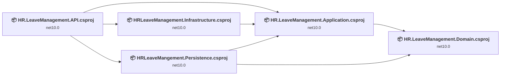
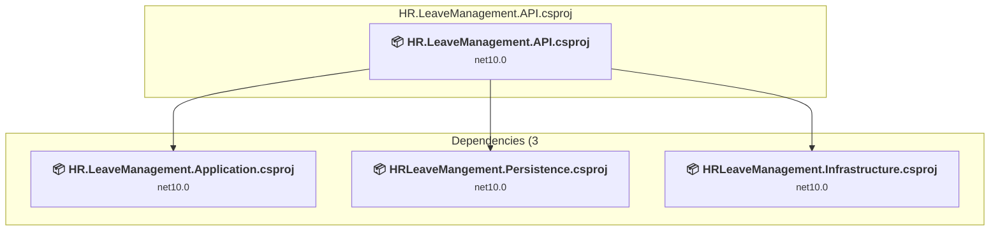
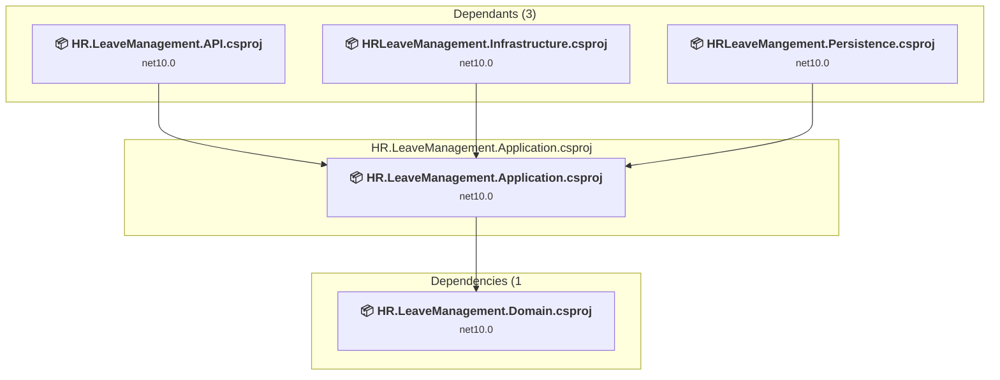
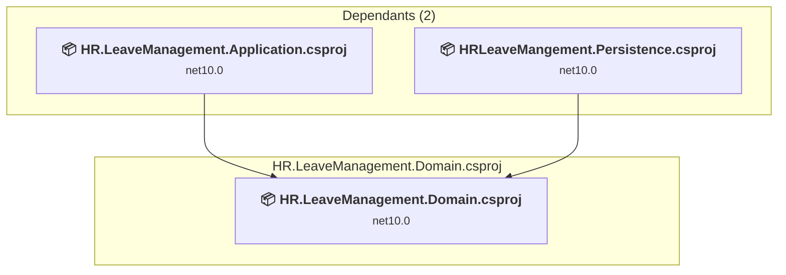
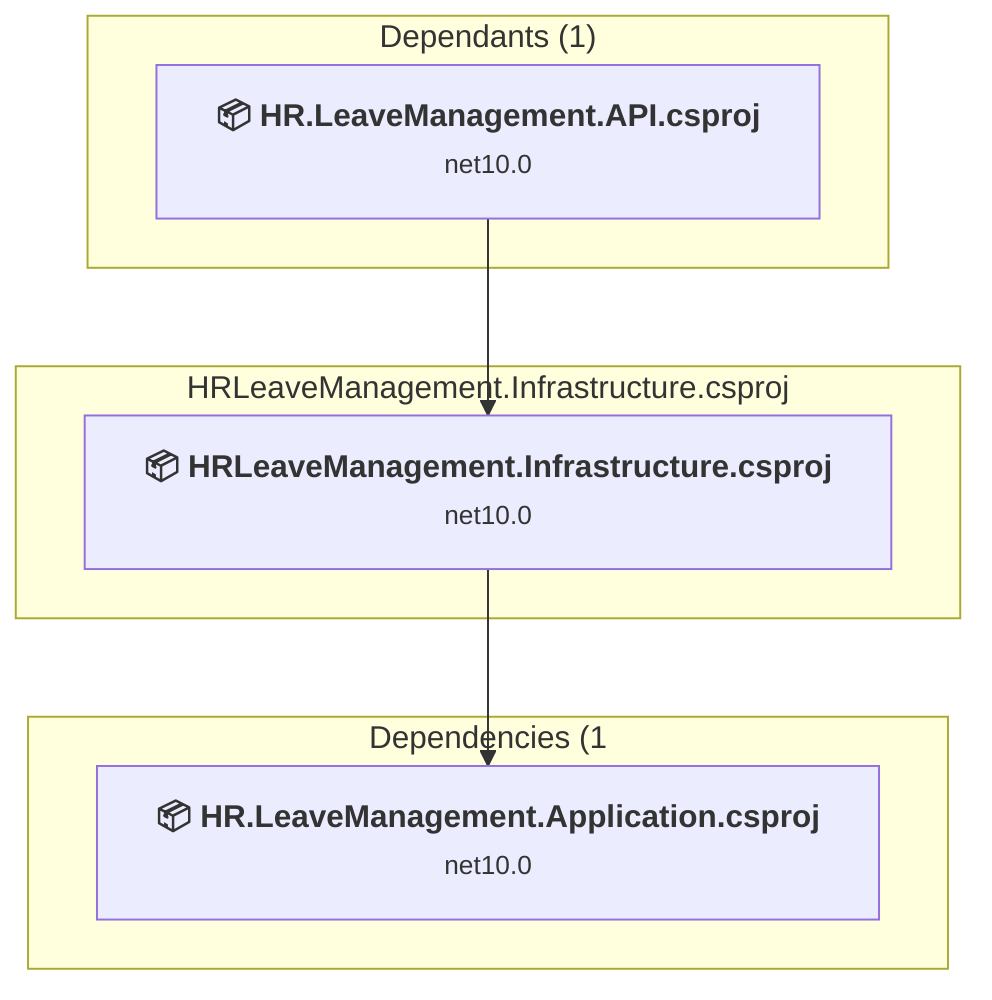
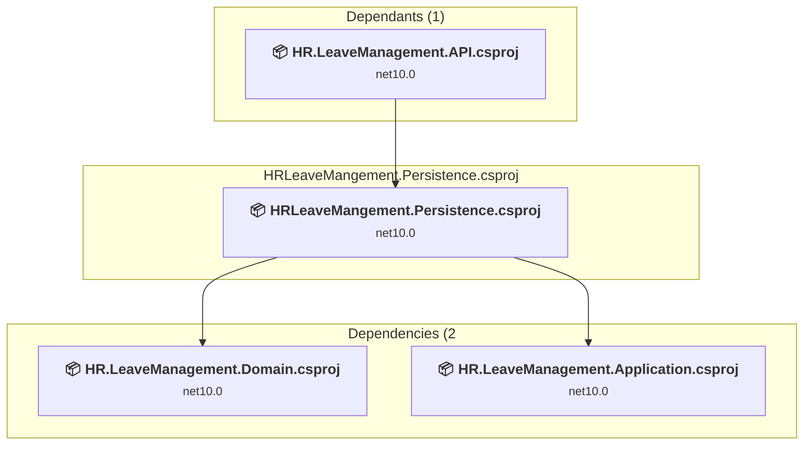

# Projects and dependencies analysis

This document provides a comprehensive overview of the projects and their dependencies in the context of upgrading to .NETCoreApp,Version=v10.0.

## Table of Contents

- [Executive Summary](#executive-Summary)
  - [Highlevel Metrics](#highlevel-metrics)
  - [Projects Compatibility](#projects-compatibility)
  - [Package Compatibility](#package-compatibility)
  - [API Compatibility](#api-compatibility)
  - [Binding Redirect Configuration](#binding-redirect-configuration)
- [Aggregate NuGet packages details](#aggregate-nuget-packages-details)
- [Top API Migration Challenges](#top-api-migration-challenges)
  - [Technologies and Features](#technologies-and-features)
  - [Most Frequent API Issues](#most-frequent-api-issues)
- [Projects Relationship Graph](#projects-relationship-graph)
- [Project Details](#project-details)

  - [HR.LeaveManagement.API\HR.LeaveManagement.API.csproj](#hrleavemanagementapihrleavemanagementapicsproj)
  - [HR.LeaveManagement.Application\HR.LeaveManagement.Application.csproj](#hrleavemanagementapplicationhrleavemanagementapplicationcsproj)
  - [HRLeaveManagement.Domain\HR.LeaveManagement.Domain.csproj](#hrleavemanagementdomainhrleavemanagementdomaincsproj)
  - [HRLeaveManagementInfrastructure\HRLeaveManagement.Infrastructure.csproj](#hrleavemanagementinfrastructurehrleavemanagementinfrastructurecsproj)
  - [HRLeaveMangement.Persistence\HRLeaveMangement.Persistence.csproj](#hrleavemangementpersistencehrleavemangementpersistencecsproj)

## Executive Summary

### Highlevel Metrics

| Metric | Count | Status |
| :--- | :---: | :--- |
| Total Projects | 5 | 0 require upgrade |
| Total NuGet Packages | 86 | All compatible |
| Total Code Files | 83 |  |
| Total Code Files with Incidents | 0 |  |
| Total Lines of Code | 1908 |  |
| Total Number of Issues | 0 |  |
| Estimated LOC to modify | 0+ | at least 0.0% of codebase |

### Projects Compatibility

| Project | Target Framework | Difficulty | Package Issues | API Issues | Binding Issues | Est. LOC Impact | Description |
| :--- | :---: | :---: | :---: | :---: | :---: | :---: | :--- |
| [HR.LeaveManagement.API\HR.LeaveManagement.API.csproj](#hrleavemanagementapihrleavemanagementapicsproj) | net10.0 | ✅ None | 0 | 0 | 0 |  | AspNetCore, Sdk Style = True |
| [HR.LeaveManagement.Application\HR.LeaveManagement.Application.csproj](#hrleavemanagementapplicationhrleavemanagementapplicationcsproj) | net10.0 | ✅ None | 0 | 0 | 0 |  | ClassLibrary, Sdk Style = True |
| [HRLeaveManagement.Domain\HR.LeaveManagement.Domain.csproj](#hrleavemanagementdomainhrleavemanagementdomaincsproj) | net10.0 | ✅ None | 0 | 0 | 0 |  | ClassLibrary, Sdk Style = True |
| [HRLeaveManagementInfrastructure\HRLeaveManagement.Infrastructure.csproj](#hrleavemanagementinfrastructurehrleavemanagementinfrastructurecsproj) | net10.0 | ✅ None | 0 | 0 | 0 |  | ClassLibrary, Sdk Style = True |
| [HRLeaveMangement.Persistence\HRLeaveMangement.Persistence.csproj](#hrleavemangementpersistencehrleavemangementpersistencecsproj) | net10.0 | ✅ None | 0 | 0 | 0 |  | ClassLibrary, Sdk Style = True |

### Package Compatibility

| Status | Count | Percentage |
| :--- | :---: | :---: |
| ✅ Compatible | 86 | 100.0% |
| ⚠️ Incompatible | 0 | 0.0% |
| 🔄 Upgrade Recommended | 0 | 0.0% |
| ***Total NuGet Packages*** | ***86*** | ***100%*** |

### API Compatibility

| Category | Count | Impact |
| :--- | :---: | :--- |
| 🔴 Binary Incompatible | 0 | High - Require code changes |
| 🟡 Source Incompatible | 0 | Medium - Needs re-compilation and potential conflicting API error fixing |
| 🔵 Behavioral change | 0 | Low - Behavioral changes that may require testing at runtime |
| ✅ Compatible | 0 |  |
| ***Total APIs Analyzed*** | ***0*** |  |

## Aggregate NuGet packages details

| Package | Current Version | Suggested Version | Projects | Description |
| :--- | :---: | :---: | :--- | :--- |
| AutoMapper | 12.0.1 |  | [HR.LeaveManagement.API.csproj](#hrleavemanagementapihrleavemanagementapicsproj) [HR.LeaveManagement.Application.csproj](#hrleavemanagementapplicationhrleavemanagementapplicationcsproj) [HRLeaveManagement.Infrastructure.csproj](#hrleavemanagementinfrastructurehrleavemanagementinfrastructurecsproj) [HRLeaveMangement.Persistence.csproj](#hrleavemangementpersistencehrleavemangementpersistencecsproj) | ✅Compatible |
| AutoMapper.Extensions.Microsoft.DependencyInjection | 12.0.1 |  | [HR.LeaveManagement.API.csproj](#hrleavemanagementapihrleavemanagementapicsproj) [HR.LeaveManagement.Application.csproj](#hrleavemanagementapplicationhrleavemanagementapplicationcsproj) [HRLeaveManagement.Infrastructure.csproj](#hrleavemanagementinfrastructurehrleavemanagementinfrastructurecsproj) [HRLeaveMangement.Persistence.csproj](#hrleavemangementpersistencehrleavemangementpersistencecsproj) | ✅Compatible |
| Azure.Core | 1.50.0 |  | [HR.LeaveManagement.API.csproj](#hrleavemanagementapihrleavemanagementapicsproj) [HRLeaveMangement.Persistence.csproj](#hrleavemangementpersistencehrleavemangementpersistencecsproj) | ✅Compatible |
| Azure.Identity | 1.17.1 |  | [HR.LeaveManagement.API.csproj](#hrleavemanagementapihrleavemanagementapicsproj) [HRLeaveMangement.Persistence.csproj](#hrleavemangementpersistencehrleavemangementpersistencecsproj) | ✅Compatible |
| FluentValidation | 12.2.0 |  | [HR.LeaveManagement.API.csproj](#hrleavemanagementapihrleavemanagementapicsproj) [HR.LeaveManagement.Application.csproj](#hrleavemanagementapplicationhrleavemanagementapplicationcsproj) [HRLeaveManagement.Infrastructure.csproj](#hrleavemanagementinfrastructurehrleavemanagementinfrastructurecsproj) [HRLeaveMangement.Persistence.csproj](#hrleavemangementpersistencehrleavemangementpersistencecsproj) | ✅Compatible |
| FluentValidation.DependencyInjectionExtensions | 12.2.0 |  | [HR.LeaveManagement.API.csproj](#hrleavemanagementapihrleavemanagementapicsproj) [HR.LeaveManagement.Application.csproj](#hrleavemanagementapplicationhrleavemanagementapplicationcsproj) [HRLeaveManagement.Infrastructure.csproj](#hrleavemanagementinfrastructurehrleavemanagementinfrastructurecsproj) [HRLeaveMangement.Persistence.csproj](#hrleavemangementpersistencehrleavemangementpersistencecsproj) | ✅Compatible |
| Humanizer.Core | 2.14.1 |  | [HRLeaveMangement.Persistence.csproj](#hrleavemangementpersistencehrleavemangementpersistencecsproj) | ✅Compatible |
| MediatR | 11.0.0 |  | [HR.LeaveManagement.API.csproj](#hrleavemanagementapihrleavemanagementapicsproj) [HR.LeaveManagement.Application.csproj](#hrleavemanagementapplicationhrleavemanagementapplicationcsproj) [HRLeaveManagement.Infrastructure.csproj](#hrleavemanagementinfrastructurehrleavemanagementinfrastructurecsproj) [HRLeaveMangement.Persistence.csproj](#hrleavemangementpersistencehrleavemangementpersistencecsproj) | ✅Compatible |
| MediatR.Contracts | 1.0.1 |  | [HR.LeaveManagement.API.csproj](#hrleavemanagementapihrleavemanagementapicsproj) [HR.LeaveManagement.Application.csproj](#hrleavemanagementapplicationhrleavemanagementapplicationcsproj) [HRLeaveManagement.Infrastructure.csproj](#hrleavemanagementinfrastructurehrleavemanagementinfrastructurecsproj) [HRLeaveMangement.Persistence.csproj](#hrleavemangementpersistencehrleavemangementpersistencecsproj) | ✅Compatible |
| MediatR.Extensions.Microsoft.DependencyInjection | 11.1.0 |  | [HR.LeaveManagement.API.csproj](#hrleavemanagementapihrleavemanagementapicsproj) [HR.LeaveManagement.Application.csproj](#hrleavemanagementapplicationhrleavemanagementapplicationcsproj) [HRLeaveManagement.Infrastructure.csproj](#hrleavemanagementinfrastructurehrleavemanagementinfrastructurecsproj) [HRLeaveMangement.Persistence.csproj](#hrleavemangementpersistencehrleavemangementpersistencecsproj) | ✅Compatible |
| Microsoft.AspNetCore.OpenApi | 10.0.12 |  | [HR.LeaveManagement.API.csproj](#hrleavemanagementapihrleavemanagementapicsproj) | ✅Compatible |
| Microsoft.Bcl.AsyncInterfaces | 8.0.0 |  | [HR.LeaveManagement.API.csproj](#hrleavemanagementapihrleavemanagementapicsproj) [HRLeaveMangement.Persistence.csproj](#hrleavemangementpersistencehrleavemangementpersistencecsproj) | ✅Compatible |
| Microsoft.Build.Framework | 18.0.2 |  | [HRLeaveMangement.Persistence.csproj](#hrleavemangementpersistencehrleavemangementpersistencecsproj) | ✅Compatible |
| Microsoft.CodeAnalysis.Analyzers | 3.11.0 |  | [HRLeaveMangement.Persistence.csproj](#hrleavemangementpersistencehrleavemangementpersistencecsproj) | ✅Compatible |
| Microsoft.CodeAnalysis.Common | 5.0.0 |  | [HRLeaveMangement.Persistence.csproj](#hrleavemangementpersistencehrleavemangementpersistencecsproj) | ✅Compatible |
| Microsoft.CodeAnalysis.CSharp | 5.0.0 |  | [HRLeaveMangement.Persistence.csproj](#hrleavemangementpersistencehrleavemangementpersistencecsproj) | ✅Compatible |
| Microsoft.CodeAnalysis.CSharp.Workspaces | 5.0.0 |  | [HRLeaveMangement.Persistence.csproj](#hrleavemangementpersistencehrleavemangementpersistencecsproj) | ✅Compatible |
| Microsoft.CodeAnalysis.Workspaces.Common | 5.0.0 |  | [HRLeaveMangement.Persistence.csproj](#hrleavemangementpersistencehrleavemangementpersistencecsproj) | ✅Compatible |
| Microsoft.CodeAnalysis.Workspaces.MSBuild | 5.0.0 |  | [HRLeaveMangement.Persistence.csproj](#hrleavemangementpersistencehrleavemangementpersistencecsproj) | ✅Compatible |
| Microsoft.Data.SqlClient | 6.1.7 |  | [HR.LeaveManagement.API.csproj](#hrleavemanagementapihrleavemanagementapicsproj) [HRLeaveMangement.Persistence.csproj](#hrleavemangementpersistencehrleavemangementpersistencecsproj) | ✅Compatible |
| Microsoft.Data.SqlClient.SNI.runtime | 6.0.3 |  | [HR.LeaveManagement.API.csproj](#hrleavemanagementapihrleavemanagementapicsproj) [HRLeaveMangement.Persistence.csproj](#hrleavemangementpersistencehrleavemangementpersistencecsproj) | ✅Compatible |
| Microsoft.EntityFrameworkCore | 10.0.13 |  | [HR.LeaveManagement.API.csproj](#hrleavemanagementapihrleavemanagementapicsproj) [HRLeaveMangement.Persistence.csproj](#hrleavemangementpersistencehrleavemangementpersistencecsproj) | ✅Compatible |
| Microsoft.EntityFrameworkCore.Abstractions | 10.0.13 |  | [HR.LeaveManagement.API.csproj](#hrleavemanagementapihrleavemanagementapicsproj) [HRLeaveMangement.Persistence.csproj](#hrleavemangementpersistencehrleavemangementpersistencecsproj) | ✅Compatible |
| Microsoft.EntityFrameworkCore.Analyzers | 10.0.13 |  | [HR.LeaveManagement.API.csproj](#hrleavemanagementapihrleavemanagementapicsproj) [HRLeaveMangement.Persistence.csproj](#hrleavemangementpersistencehrleavemangementpersistencecsproj) | ✅Compatible |
| Microsoft.EntityFrameworkCore.Design | 10.0.13 |  | [HRLeaveMangement.Persistence.csproj](#hrleavemangementpersistencehrleavemangementpersistencecsproj) | ✅Compatible |
| Microsoft.EntityFrameworkCore.Relational | 10.0.13 |  | [HR.LeaveManagement.API.csproj](#hrleavemanagementapihrleavemanagementapicsproj) [HRLeaveMangement.Persistence.csproj](#hrleavemangementpersistencehrleavemangementpersistencecsproj) | ✅Compatible |
| Microsoft.EntityFrameworkCore.SqlServer | 10.0.13 |  | [HR.LeaveManagement.API.csproj](#hrleavemanagementapihrleavemanagementapicsproj) [HRLeaveMangement.Persistence.csproj](#hrleavemangementpersistencehrleavemangementpersistencecsproj) | ✅Compatible |
| Microsoft.EntityFrameworkCore.Tools | 10.0.13 |  | [HRLeaveMangement.Persistence.csproj](#hrleavemangementpersistencehrleavemangementpersistencecsproj) | ✅Compatible |
| Microsoft.Extensions.ApiDescription.Server | 10.0.0 |  | [HR.LeaveManagement.API.csproj](#hrleavemanagementapihrleavemanagementapicsproj) | ✅Compatible |
| Microsoft.Extensions.Caching.Abstractions | 10.0.13 |  | [HRLeaveMangement.Persistence.csproj](#hrleavemangementpersistencehrleavemangementpersistencecsproj) | ✅Compatible |
| Microsoft.Extensions.Caching.Memory | 10.0.13 |  | [HRLeaveMangement.Persistence.csproj](#hrleavemangementpersistencehrleavemangementpersistencecsproj) | ✅Compatible |
| Microsoft.Extensions.Configuration | 10.0.13 |  | [HRLeaveManagement.Infrastructure.csproj](#hrleavemanagementinfrastructurehrleavemanagementinfrastructurecsproj) [HRLeaveMangement.Persistence.csproj](#hrleavemangementpersistencehrleavemangementpersistencecsproj) | ✅Compatible |
| Microsoft.Extensions.Configuration.Abstractions | 10.0.13 |  | [HRLeaveManagement.Infrastructure.csproj](#hrleavemanagementinfrastructurehrleavemanagementinfrastructurecsproj) [HRLeaveMangement.Persistence.csproj](#hrleavemangementpersistencehrleavemangementpersistencecsproj) | ✅Compatible |
| Microsoft.Extensions.Configuration.Binder | 10.0.13 |  | [HRLeaveManagement.Infrastructure.csproj](#hrleavemanagementinfrastructurehrleavemanagementinfrastructurecsproj) [HRLeaveMangement.Persistence.csproj](#hrleavemangementpersistencehrleavemangementpersistencecsproj) | ✅Compatible |
| Microsoft.Extensions.Configuration.FileExtensions | 10.0.13 |  | [HRLeaveMangement.Persistence.csproj](#hrleavemangementpersistencehrleavemangementpersistencecsproj) | ✅Compatible |
| Microsoft.Extensions.Configuration.Json | 10.0.13 |  | [HRLeaveMangement.Persistence.csproj](#hrleavemangementpersistencehrleavemangementpersistencecsproj) | ✅Compatible |
| Microsoft.Extensions.DependencyInjection | 10.0.13 |  | [HRLeaveMangement.Persistence.csproj](#hrleavemangementpersistencehrleavemangementpersistencecsproj) | ✅Compatible |
| Microsoft.Extensions.DependencyInjection.Abstractions | 10.0.13 |  | [HRLeaveManagement.Infrastructure.csproj](#hrleavemanagementinfrastructurehrleavemanagementinfrastructurecsproj) [HRLeaveMangement.Persistence.csproj](#hrleavemangementpersistencehrleavemangementpersistencecsproj) | ✅Compatible |
| Microsoft.Extensions.DependencyInjection.Abstractions | 7.0.0 |  | [HR.LeaveManagement.Application.csproj](#hrleavemanagementapplicationhrleavemanagementapplicationcsproj) | ✅Compatible |
| Microsoft.Extensions.DependencyModel | 10.0.13 |  | [HRLeaveMangement.Persistence.csproj](#hrleavemangementpersistencehrleavemangementpersistencecsproj) | ✅Compatible |
| Microsoft.Extensions.FileProviders.Abstractions | 10.0.13 |  | [HRLeaveMangement.Persistence.csproj](#hrleavemangementpersistencehrleavemangementpersistencecsproj) | ✅Compatible |
| Microsoft.Extensions.FileProviders.Physical | 10.0.13 |  | [HRLeaveMangement.Persistence.csproj](#hrleavemangementpersistencehrleavemangementpersistencecsproj) | ✅Compatible |
| Microsoft.Extensions.FileSystemGlobbing | 10.0.13 |  | [HRLeaveMangement.Persistence.csproj](#hrleavemangementpersistencehrleavemangementpersistencecsproj) | ✅Compatible |
| Microsoft.Extensions.Logging | 10.0.13 |  | [HRLeaveMangement.Persistence.csproj](#hrleavemangementpersistencehrleavemangementpersistencecsproj) | ✅Compatible |
| Microsoft.Extensions.Logging.Abstractions | 10.0.13 |  | [HRLeaveMangement.Persistence.csproj](#hrleavemangementpersistencehrleavemangementpersistencecsproj) | ✅Compatible |
| Microsoft.Extensions.Options | 10.0.13 |  | [HRLeaveManagement.Infrastructure.csproj](#hrleavemanagementinfrastructurehrleavemanagementinfrastructurecsproj) [HRLeaveMangement.Persistence.csproj](#hrleavemangementpersistencehrleavemangementpersistencecsproj) | ✅Compatible |
| Microsoft.Extensions.Options | 6.0.0 |  | [HR.LeaveManagement.Application.csproj](#hrleavemanagementapplicationhrleavemanagementapplicationcsproj) | ✅Compatible |
| Microsoft.Extensions.Options.ConfigurationExtensions | 10.0.13 |  | [HRLeaveManagement.Infrastructure.csproj](#hrleavemanagementinfrastructurehrleavemanagementinfrastructurecsproj) [HRLeaveMangement.Persistence.csproj](#hrleavemangementpersistencehrleavemangementpersistencecsproj) | ✅Compatible |
| Microsoft.Extensions.Primitives | 10.0.13 |  | [HRLeaveManagement.Infrastructure.csproj](#hrleavemanagementinfrastructurehrleavemanagementinfrastructurecsproj) [HRLeaveMangement.Persistence.csproj](#hrleavemangementpersistencehrleavemangementpersistencecsproj) | ✅Compatible |
| Microsoft.Extensions.Primitives | 6.0.0 |  | [HR.LeaveManagement.Application.csproj](#hrleavemanagementapplicationhrleavemanagementapplicationcsproj) | ✅Compatible |
| Microsoft.Identity.Client | 4.84.2 |  | [HR.LeaveManagement.API.csproj](#hrleavemanagementapihrleavemanagementapicsproj) [HRLeaveMangement.Persistence.csproj](#hrleavemangementpersistencehrleavemangementpersistencecsproj) | ✅Compatible |
| Microsoft.Identity.Client.Broker | 4.84.2 |  | [HR.LeaveManagement.API.csproj](#hrleavemanagementapihrleavemanagementapicsproj) [HRLeaveMangement.Persistence.csproj](#hrleavemangementpersistencehrleavemangementpersistencecsproj) | ✅Compatible |
| Microsoft.Identity.Client.Extensions.Msal | 4.78.0 |  | [HR.LeaveManagement.API.csproj](#hrleavemanagementapihrleavemanagementapicsproj) [HRLeaveMangement.Persistence.csproj](#hrleavemangementpersistencehrleavemangementpersistencecsproj) | ✅Compatible |
| Microsoft.Identity.Client.NativeInterop | 0.20.6 |  | [HR.LeaveManagement.API.csproj](#hrleavemanagementapihrleavemanagementapicsproj) [HRLeaveMangement.Persistence.csproj](#hrleavemangementpersistencehrleavemangementpersistencecsproj) | ✅Compatible |
| Microsoft.IdentityModel.Abstractions | 8.14.0 |  | [HR.LeaveManagement.API.csproj](#hrleavemanagementapihrleavemanagementapicsproj) [HRLeaveMangement.Persistence.csproj](#hrleavemangementpersistencehrleavemangementpersistencecsproj) | ✅Compatible |
| Microsoft.IdentityModel.JsonWebTokens | 7.7.1 |  | [HR.LeaveManagement.API.csproj](#hrleavemanagementapihrleavemanagementapicsproj) [HRLeaveMangement.Persistence.csproj](#hrleavemangementpersistencehrleavemangementpersistencecsproj) | ✅Compatible |
| Microsoft.IdentityModel.Logging | 7.7.1 |  | [HR.LeaveManagement.API.csproj](#hrleavemanagementapihrleavemanagementapicsproj) [HRLeaveMangement.Persistence.csproj](#hrleavemangementpersistencehrleavemangementpersistencecsproj) | ✅Compatible |
| Microsoft.IdentityModel.Protocols | 7.7.1 |  | [HR.LeaveManagement.API.csproj](#hrleavemanagementapihrleavemanagementapicsproj) [HRLeaveMangement.Persistence.csproj](#hrleavemangementpersistencehrleavemangementpersistencecsproj) | ✅Compatible |
| Microsoft.IdentityModel.Protocols.OpenIdConnect | 7.7.1 |  | [HR.LeaveManagement.API.csproj](#hrleavemanagementapihrleavemanagementapicsproj) [HRLeaveMangement.Persistence.csproj](#hrleavemangementpersistencehrleavemangementpersistencecsproj) | ✅Compatible |
| Microsoft.IdentityModel.Tokens | 7.7.1 |  | [HR.LeaveManagement.API.csproj](#hrleavemanagementapihrleavemanagementapicsproj) [HRLeaveMangement.Persistence.csproj](#hrleavemangementpersistencehrleavemangementpersistencecsproj) | ✅Compatible |
| Microsoft.OpenApi | 2.12.0 |  | [HR.LeaveManagement.API.csproj](#hrleavemanagementapihrleavemanagementapicsproj) | ✅Compatible |
| Microsoft.SqlServer.Server | 1.0.0 |  | [HR.LeaveManagement.API.csproj](#hrleavemanagementapihrleavemanagementapicsproj) [HRLeaveMangement.Persistence.csproj](#hrleavemangementpersistencehrleavemangementpersistencecsproj) | ✅Compatible |
| Microsoft.VisualStudio.SolutionPersistence | 1.0.52 |  | [HRLeaveMangement.Persistence.csproj](#hrleavemangementpersistencehrleavemangementpersistencecsproj) | ✅Compatible |
| Mono.TextTemplating | 3.0.0 |  | [HRLeaveMangement.Persistence.csproj](#hrleavemangementpersistencehrleavemangementpersistencecsproj) | ✅Compatible |
| Newtonsoft.Json | 13.0.1 |  | [HR.LeaveManagement.API.csproj](#hrleavemanagementapihrleavemanagementapicsproj) [HRLeaveManagement.Infrastructure.csproj](#hrleavemanagementinfrastructurehrleavemanagementinfrastructurecsproj) | ✅Compatible |
| Newtonsoft.Json | 13.0.4 |  | [HRLeaveMangement.Persistence.csproj](#hrleavemangementpersistencehrleavemangementpersistencecsproj) | ✅Compatible |
| SendGrid | 9.29.3 |  | [HR.LeaveManagement.API.csproj](#hrleavemanagementapihrleavemanagementapicsproj) [HRLeaveManagement.Infrastructure.csproj](#hrleavemanagementinfrastructurehrleavemanagementinfrastructurecsproj) | ✅Compatible |
| starkbank-ecdsa | 1.3.3 |  | [HR.LeaveManagement.API.csproj](#hrleavemanagementapihrleavemanagementapicsproj) [HRLeaveManagement.Infrastructure.csproj](#hrleavemanagementinfrastructurehrleavemanagementinfrastructurecsproj) | ✅Compatible |
| Swashbuckle.AspNetCore | 10.0.1 |  | [HR.LeaveManagement.API.csproj](#hrleavemanagementapihrleavemanagementapicsproj) | ✅Compatible |
| Swashbuckle.AspNetCore.Swagger | 10.0.1 |  | [HR.LeaveManagement.API.csproj](#hrleavemanagementapihrleavemanagementapicsproj) | ✅Compatible |
| Swashbuckle.AspNetCore.SwaggerGen | 10.0.1 |  | [HR.LeaveManagement.API.csproj](#hrleavemanagementapihrleavemanagementapicsproj) | ✅Compatible |
| Swashbuckle.AspNetCore.SwaggerUI | 10.0.1 |  | [HR.LeaveManagement.API.csproj](#hrleavemanagementapihrleavemanagementapicsproj) | ✅Compatible |
| System.ClientModel | 1.8.0 |  | [HR.LeaveManagement.API.csproj](#hrleavemanagementapihrleavemanagementapicsproj) [HRLeaveMangement.Persistence.csproj](#hrleavemangementpersistencehrleavemangementpersistencecsproj) | ✅Compatible |
| System.CodeDom | 6.0.0 |  | [HRLeaveMangement.Persistence.csproj](#hrleavemangementpersistencehrleavemangementpersistencecsproj) | ✅Compatible |
| System.Composition | 9.0.0 |  | [HRLeaveMangement.Persistence.csproj](#hrleavemangementpersistencehrleavemangementpersistencecsproj) | ✅Compatible |
| System.Composition.AttributedModel | 9.0.0 |  | [HRLeaveMangement.Persistence.csproj](#hrleavemangementpersistencehrleavemangementpersistencecsproj) | ✅Compatible |
| System.Composition.Convention | 9.0.0 |  | [HRLeaveMangement.Persistence.csproj](#hrleavemangementpersistencehrleavemangementpersistencecsproj) | ✅Compatible |
| System.Composition.Hosting | 9.0.0 |  | [HRLeaveMangement.Persistence.csproj](#hrleavemangementpersistencehrleavemangementpersistencecsproj) | ✅Compatible |
| System.Composition.Runtime | 9.0.0 |  | [HRLeaveMangement.Persistence.csproj](#hrleavemangementpersistencehrleavemangementpersistencecsproj) | ✅Compatible |
| System.Composition.TypedParts | 9.0.0 |  | [HRLeaveMangement.Persistence.csproj](#hrleavemangementpersistencehrleavemangementpersistencecsproj) | ✅Compatible |
| System.Configuration.ConfigurationManager | 9.0.11 |  | [HR.LeaveManagement.API.csproj](#hrleavemanagementapihrleavemanagementapicsproj) [HRLeaveMangement.Persistence.csproj](#hrleavemangementpersistencehrleavemangementpersistencecsproj) | ✅Compatible |
| System.Diagnostics.EventLog | 9.0.11 |  | [HRLeaveMangement.Persistence.csproj](#hrleavemangementpersistencehrleavemangementpersistencecsproj) | ✅Compatible |
| System.IdentityModel.Tokens.Jwt | 7.7.1 |  | [HR.LeaveManagement.API.csproj](#hrleavemanagementapihrleavemanagementapicsproj) [HRLeaveMangement.Persistence.csproj](#hrleavemangementpersistencehrleavemangementpersistencecsproj) | ✅Compatible |
| System.Memory.Data | 8.0.1 |  | [HR.LeaveManagement.API.csproj](#hrleavemanagementapihrleavemanagementapicsproj) [HRLeaveMangement.Persistence.csproj](#hrleavemangementpersistencehrleavemangementpersistencecsproj) | ✅Compatible |
| System.Security.Cryptography.Pkcs | 9.0.11 |  | [HR.LeaveManagement.API.csproj](#hrleavemanagementapihrleavemanagementapicsproj) [HRLeaveMangement.Persistence.csproj](#hrleavemangementpersistencehrleavemangementpersistencecsproj) | ✅Compatible |
| System.Security.Cryptography.ProtectedData | 9.0.11 |  | [HR.LeaveManagement.API.csproj](#hrleavemanagementapihrleavemanagementapicsproj) [HRLeaveMangement.Persistence.csproj](#hrleavemangementpersistencehrleavemangementpersistencecsproj) | ✅Compatible |

## Top API Migration Challenges

### Technologies and Features

| Technology | Issues | Percentage | Migration Path |
| :--- | :---: | :---: | :--- |

### Most Frequent API Issues

| API | Count | Percentage | Category |
| :--- | :---: | :---: | :--- |

## Projects Relationship Graph

Legend:
📦 SDK-style project
⚙️ Classic project

## Project Details

### HR.LeaveManagement.API\HR.LeaveManagement.API.csproj

#### Project Info

- **Current Target Framework:** net10.0✅
- **SDK-style**: True
- **Project Kind:** AspNetCore
- **Dependencies**: 3
- **Dependants**: 0
- **Number of Files**: 5
- **Lines of Code**: 89
- **Estimated LOC to modify**: 0+ (at least 0.0% of the project)

#### Dependency Graph

Legend:
📦 SDK-style project
⚙️ Classic project

### API Compatibility

| Category | Count | Impact |
| :--- | :---: | :--- |
| 🔴 Binary Incompatible | 0 | High - Require code changes |
| 🟡 Source Incompatible | 0 | Medium - Needs re-compilation and potential conflicting API error fixing |
| 🔵 Behavioral change | 0 | Low - Behavioral changes that may require testing at runtime |
| ✅ Compatible | 0 |  |
| ***Total APIs Analyzed*** | ***0*** |  |

### HR.LeaveManagement.Application\HR.LeaveManagement.Application.csproj

#### Project Info

- **Current Target Framework:** net10.0✅
- **SDK-style**: True
- **Project Kind:** ClassLibrary
- **Dependencies**: 1
- **Dependants**: 3
- **Number of Files**: 67
- **Lines of Code**: 1460
- **Estimated LOC to modify**: 0+ (at least 0.0% of the project)

#### Dependency Graph

Legend:
📦 SDK-style project
⚙️ Classic project

### API Compatibility

| Category | Count | Impact |
| :--- | :---: | :--- |
| 🔴 Binary Incompatible | 0 | High - Require code changes |
| 🟡 Source Incompatible | 0 | Medium - Needs re-compilation and potential conflicting API error fixing |
| 🔵 Behavioral change | 0 | Low - Behavioral changes that may require testing at runtime |
| ✅ Compatible | 0 |  |
| ***Total APIs Analyzed*** | ***0*** |  |

### HRLeaveManagement.Domain\HR.LeaveManagement.Domain.csproj

#### Project Info

- **Current Target Framework:** net10.0✅
- **SDK-style**: True
- **Project Kind:** ClassLibrary
- **Dependencies**: 0
- **Dependants**: 2
- **Number of Files**: 4
- **Lines of Code**: 65
- **Estimated LOC to modify**: 0+ (at least 0.0% of the project)

#### Dependency Graph

Legend:
📦 SDK-style project
⚙️ Classic project

### API Compatibility

| Category | Count | Impact |
| :--- | :---: | :--- |
| 🔴 Binary Incompatible | 0 | High - Require code changes |
| 🟡 Source Incompatible | 0 | Medium - Needs re-compilation and potential conflicting API error fixing |
| 🔵 Behavioral change | 0 | Low - Behavioral changes that may require testing at runtime |
| ✅ Compatible | 0 |  |
| ***Total APIs Analyzed*** | ***0*** |  |

### HRLeaveManagementInfrastructure\HRLeaveManagement.Infrastructure.csproj

#### Project Info

- **Current Target Framework:** net10.0✅
- **SDK-style**: True
- **Project Kind:** ClassLibrary
- **Dependencies**: 1
- **Dependants**: 1
- **Number of Files**: 2
- **Lines of Code**: 56
- **Estimated LOC to modify**: 0+ (at least 0.0% of the project)

#### Dependency Graph

Legend:
📦 SDK-style project
⚙️ Classic project

### API Compatibility

| Category | Count | Impact |
| :--- | :---: | :--- |
| 🔴 Binary Incompatible | 0 | High - Require code changes |
| 🟡 Source Incompatible | 0 | Medium - Needs re-compilation and potential conflicting API error fixing |
| 🔵 Behavioral change | 0 | Low - Behavioral changes that may require testing at runtime |
| ✅ Compatible | 0 |  |
| ***Total APIs Analyzed*** | ***0*** |  |

### HRLeaveMangement.Persistence\HRLeaveMangement.Persistence.csproj

#### Project Info

- **Current Target Framework:** net10.0✅
- **SDK-style**: True
- **Project Kind:** ClassLibrary
- **Dependencies**: 2
- **Dependants**: 1
- **Number of Files**: 7
- **Lines of Code**: 238
- **Estimated LOC to modify**: 0+ (at least 0.0% of the project)

#### Dependency Graph

Legend:
📦 SDK-style project
⚙️ Classic project

### API Compatibility

| Category | Count | Impact |
| :--- | :---: | :--- |
| 🔴 Binary Incompatible | 0 | High - Require code changes |
| 🟡 Source Incompatible | 0 | Medium - Needs re-compilation and potential conflicting API error fixing |
| 🔵 Behavioral change | 0 | Low - Behavioral changes that may require testing at runtime |
| ✅ Compatible | 0 |  |
| ***Total APIs Analyzed*** | ***0*** |  |

